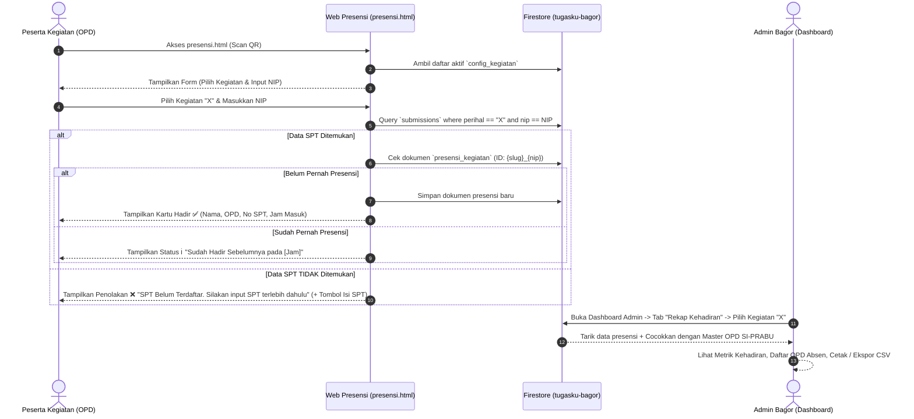

# Spesifikasi Desain: Daftar Hadir Kegiatan & Rekap Kehadiran OPD

**Tanggal**: 2026-10-12  
**Status**: Disetujui  
**Aplikasi**: Kirim SPT Digital Bagor (`sptdigitalbagor`)  
**Basis Data**: Cloud Firestore (`tugasku-bagor`)  

---

## 1. Ringkasan & Latar Belakang

Fitur **Daftar Hadir Kegiatan** dikembangkan untuk memudahkan presensi digital pada setiap acara/kegiatan resmi kedinasan pemerintah Kabupaten Muaro Jambi yang diadakan oleh Bagian Organisasi.

### Prinsip Utama Sistem:
1. **Kegiatan Dinamis**: Daftar kegiatan diambil langsung dari kegiatan aktif yang ada di sistem (`config_kegiatan`).
2. **Wajib SPT (Prasyarat Mutlak)**: Peserta kegiatan hanya dapat dinyatakan sah hadir jika sebelumnya telah mengirimkan dan terdaftar pada Surat Perintah Tugas (SPT) untuk kegiatan tersebut di sistem SPT Digital.
3. **Konfirmasi Mandiri Cepat (Mobile-Friendly)**: Disediakan halaman mandiri publik `presensi.html` yang dapat diakses melalui pemindaian QR Code di venue/meja registrasi. Peserta cukup memilih kegiatan dan memasukkan NIP.
4. **Monitoring & Evaluasi Admin**: Admin memiliki sub-tab khusus di dashboard untuk memantau kehadiran per kegiatan, merangkum OPD mana saja yang belum hadir/absen, serta mengekspor atau mencetak laporan kehadiran.

---

## 2. Arsitektur Data & Alur Sistem



---

## 3. Skema Data Firestore

### 3.1. Koleksi Baru: `presensi_kegiatan`
Document ID dirancang unik (*idempotent*) untuk mencegah duplikasi:  
`docId = encodeURIComponent(kegiatan) + "_" + nip`

| Field | Tipe | Keterangan |
| :--- | :--- | :--- |
| `id` | String | ID unik dokumen (`{slug_kegiatan}_{nip}`) |
| `kegiatan` | String | Nama kegiatan resmi yang dipilih |
| `nip` | String | NIP 18 digit peserta |
| `nama` | String | Nama lengkap dan gelar dari data SPT |
| `opd` | String | Unit Kerja / OPD pengirim SPT |
| `opdId` | String | ID OPD jika tersedia pada data SPT |
| `jabatan` | String | Jabatan peserta dari data SPT |
| `statusPegawai` | String | Status PNS / PPPK / Non-ASN |
| `submissionId` | String | ID dokumen referensi di koleksi `submissions` |
| `nomorSpt` | String | Nomor register resmi SPT |
| `waktuCheckIn` | String | Format tanggal lokal (e.g. `2026-10-12 08:35:10`) |
| `createdAt` | Timestamp / ISO | Timestamp presensi |
| `userAgent` | String | Informasi browser/perangkat saat konfirmasi |
| `source` | String | `"web_presensi"` |

### 3.2. Aturan Keamanan (`firestore.rules`)
```javascript
match /presensi_kegiatan/{presensiId} {
  // Publik boleh membaca data presensi (untuk verifikasi mandiri & dashboard)
  allow read: if true;
  // Publik boleh membuat data presensi baru (check-in)
  allow create: if true;
  // Update dan delete dilarang untuk publik (hanya bisa dikelola via admin)
  allow update, delete: if false;
}
```

---

## 4. Antarmuka Peserta (`presensi.html`)

Halaman mandiri yang berdiri sendiri dengan tema visual konsisten (Clean Blue Modern / Ukraine Theme):
1. **Header Branding**: Logo Pemkab Muaro Jambi, lencana sistem, judul halaman yang ramah pengguna.
2. **Formulir Presensi Interaktif**:
   - Dropdown Pilihan Kegiatan (mengambil realtime dari `config_kegiatan`).
   - Input NIP Peserta (validasi digit numerik, keypad angka otomatis pada ponsel).
   - Tombol Aksi: *"📍 Konfirmasi Hadir"* dengan animasi *loading state*.
3. **Feedback Cards Dinamis**:
   - **Sukses Baru (Hijau)**: Menampilkan kartu konfirmasi lengkap (Nama, NIP, OPD, Jabatan, Nomor SPT, Waktu Hadir).
   - **Sudah Terdaftar (Biru)**: Menampilkan informasi bahwa peserta sudah melakukan check-in sebelumnya beserta catatan jam pertama hadir.
   - **Belum Ada SPT (Merah/Amber)**: Menampilkan notifikasi bahwa SPT belum terdaftar pada kegiatan tersebut, disertai tombol CTA: *"📝 Isi Formulir SPT Sekarang"* yang langsung mengarahkan ke form utama dengan perihal kegiatan yang sudah otomatis terisi.

---

## 5. Dashboard Admin: Rekap Kehadiran & Monitoring OPD

Ditambahkan sub-tab baru pada panel Admin: **`📋 Rekap Kehadiran` (`kehadiran-panel`)**.

### 5.1. Komponen Fitur:
1. **Filter Kegiatan**: Memilih kegiatan yang sedang berlangsung atau yang telah selesai.
2. **Statistik Kehadiran (Kartu Metrik)**:
   - Total OPD Utama (dari master data SI-PRABU `sianjabUnits`).
   - OPD Hadir (jumlah dinas/badan/kecamatan yang hadir).
   - OPD Belum Hadir (jumlah instansi yang belum ada perwakilan sama sekali).
   - Persentase Tingkat Kehadiran Instansi (%).
   - Total Individu Peserta yang Hadir.
3. **Pemantauan OPD Belum Hadir (Absensi OPD)**:
   - Daftar nama OPD yang belum hadir dalam format tabel/kartu visual.
   - Tombol **"📋 Salin Daftar Absen (WhatsApp)"** untuk kemudahan panitia membagikan daftar OPD yang belum hadir ke pimpinan atau grup koordinasi.
4. **Tabel Rincian Peserta Hadir**:
   - Daftar nama peserta yang telah hadir beserta NIP, OPD, Jabatan, Nomor SPT, dan Jam Check-in.
   - Kolom pencarian instan (filter nama/NIP/OPD).
5. **Ekspor & Cetak Dokumen**:
   - Tombol **"🖨️ Cetak Lembar Hadir"**: Mengaktifkan layout cetak rapi siap tandatangan / simpan PDF.
   - Tombol **"📥 Unduh CSV/Excel"**: Mengunduh rekapitulasi data kehadiran peserta kegiatan.

---

## 6. Integrasi Build & Deployment

1. **Sumber Berkas**:
   - `apps_script/Presensi.html` dibuat sebagai master template presensi mandiri.
   - `apps_script/Index.html` diperbarui dengan penambahan sub-tab `kehadiran-panel` pada dashboard admin.
2. **Pembaruan `build.js`**:
   - Memproses `apps_script/Presensi.html` menjadi `public/presensi.html` lengkap dengan injeksi konfigurasi Firebase SDK dan Firestore adapter.
   - Memperbarui `firestore.rules` agar mencakup izin koleksi `presensi_kegiatan`.
3. **Deployment**:
   - File statis terdistribusi ke Firebase Hosting, sehingga dapat diakses cepat di `https://tugasku-bagor.web.app/presensi.html`.
